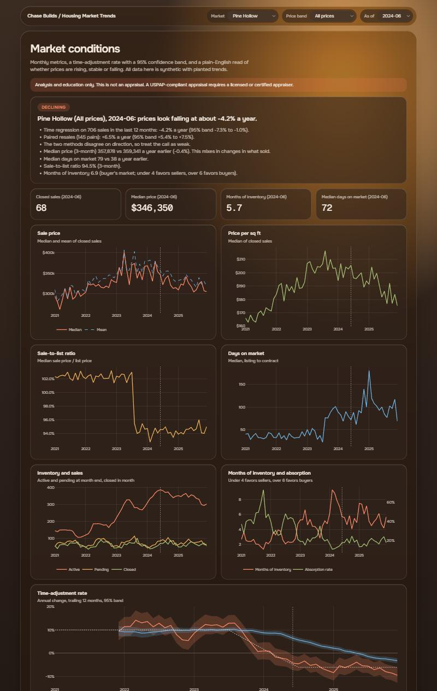

# housing-market-trends

[](https://github.com/chasebuilds/housing-market-trends/actions/workflows/ci.yml)
[](LICENSE)

**Live dashboard: https://chasebuilds.github.io/housing-market-trends/**

Market-conditions analysis for appraisers, agents and assessors. It turns a sales and listings history into monthly metrics by market and price band, estimates a time-adjustment rate with a 95% confidence band, and writes a plain-English read: prices increasing, stable or declining, with the evidence.

> **Analysis and education tool, not an appraisal.** A USPAP-compliant appraisal requires a licensed or certified appraiser. Nothing here replaces that, and the demo data is synthetic.



## What it shows

Per market and price band, by month:

| Metric | Definition |
|---|---|
| Closed | Sales with a close date in the month |
| Median / mean price | Of those closed sales |
| Price per sq ft | Median of sale price / living area |
| Sale-to-list ratio | Median of sale price / list price |
| Days on market | Median of listing date to contract date |
| Active | Listed by month end, not under contract, not withdrawn |
| Pending | Under contract at month end, not yet closed |
| Absorption rate | Closed / active at month end |
| Months of inventory | Active at month end / closed in the month |
| Time-adjustment rate | Annual price change, trailing 12 months, 95% band, two methods |

Closed sales are banded by sale price, active and pending listings by list price.

**Time adjustment, two ways.** *Paired resales*: for homes that sold twice, regress ln(price2 / price1) on months between the sales, through the origin. *Time regression*: regress ln(price) on ln(sq ft), age, bedrooms and months over the last 12 months of sales. Both give a monthly log change, shown as an annual rate with a t-based 95% band.

**Market conditions summary.** "Increasing" or "declining" needs a rate of at least 3% a year whose 95% band excludes zero. Anything else is "stable" and the headline says there is no clear direction. The evidence list adds the paired-resale result (and flags when the two methods disagree), median price against a year earlier, days on market, sale-to-list ratio and months of inventory (under 4 favors sellers, over 6 favors buyers).

**Dashboard.** One static HTML file: filters for market, price band and as-of month; seven charts; CSV export for the selected market and band, or everything. Charts use Plotly (basic bundle from jsDelivr).

## Data

Everything is synthetic and seeded (`seed=42`). Four invented markets, 60 months (2021-01 to 2025-12), 16,069 MLS-style listings, 22% of sales being resales of an earlier sale, 15% of listings withdrawn unsold. Each market has a planted annual price path, so estimates can be scored against a known answer:

| Market | Planted trend |
|---|---|
| Maple Ridge | steady +8% a year |
| Stonebrook | flat, 0% a year |
| Pine Hollow | +10% a year for 30 months, then -6% a year |
| Lakeshore Bend | steady -5% a year |

Sale price = a hedonic value (size, age, bedrooms, persistent per-home quality) times the planted index times noise. Days on market and sale-to-list ratio respond to the planted trend. No real people, owners or addresses appear anywhere.

Public series such as the FHFA House Price Index were left out on purpose: reuse terms were not checked, and the demo does not need them. If you load your own MLS export, map it to the columns in `synth.generate` (listing, property, market, list / pending / close / withdrawn dates, list and sale price, sq ft, beds, year built).

## Benchmark: do the planted trends come back?

`python -m housing_market_trends.benchmark` writes [BENCHMARK.md](BENCHMARK.md). Trailing 12-month windows, all prices, error in percentage points against the planted annual change:

| Method | Windows | Mean abs error | Bias | Truth inside 95% band |
|---|---|---|---|---|
| Time regression | 196 | 1.55 pp | +0.21 pp | 95% |
| Paired resales | 196 | 1.56 pp | +0.99 pp | 77% |

The condition label matched the planted direction in 176 of 196 market-months (90%). Paired resales are accurate in steady markets (0.4 to 0.9 pp error) but lag a turn: in Pine Hollow their error is 4.3 pp. Inside a single price band the regression gets worse (1.9 to 3.4 pp error, 63% to 100% band coverage by band), because cutting a band on sale price truncates the thing being modeled.

## Run it

```
pip install -e ".[dev]"
hmt build                      # writes dist/index.html, metrics.csv, time_adjustment.csv, listings_synthetic.csv
hmt summary "Pine Hollow" --month 2024-06
python -m housing_market_trends.benchmark
pytest -q                      # 47 tests
ruff check . && mypy src
```

Tests cover every metric with a seven-listing example worked out by hand (March 2025: 3 closed, median price 247,000, 1 active, 1 pending, absorption 3.0, months of inventory 1/3), the band boundaries, both time-adjustment estimators (exact recovery on noise-free data, a three-pair slope and error worked by hand), the summary rules, determinism of the generator, and the planted-trend benchmark.

## LIMITATIONS

- Not an appraisal and not a valuation of any property. Appraisal work needs a licensed or certified appraiser and their judgment of the specific property.
- The data is synthetic. Real markets have neighborhoods, condition, financing and seasonality effects that this generator only partly models, so the measured errors will be worse on real data.
- Trailing 12-month windows lag turning points. Paired resales lag more.
- Small cells are noisy. A band with few sales gives a wide band or no estimate (the regression needs 40 sales, the pair method 12 pairs).
- Banded regressions are biased because the band is cut on sale price.
- Median price changes mix in changes in what sold; they are not an index.
- Closed sales and open listings are banded on different prices (sale vs list), so months of inventory by band is approximate.
- The 3% threshold and the 4 / 6 months-of-inventory cut points are common rules of thumb, not standards.

## License

MIT, Chase Builds. See [LICENSE](LICENSE).
